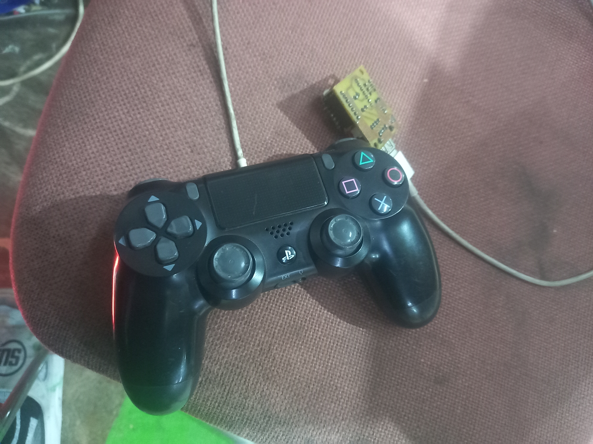
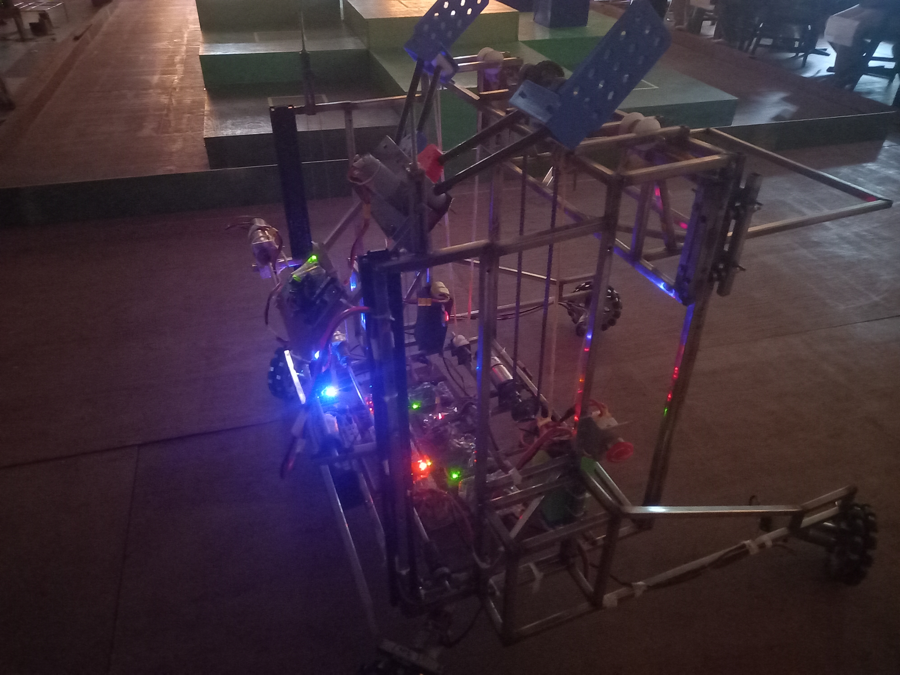
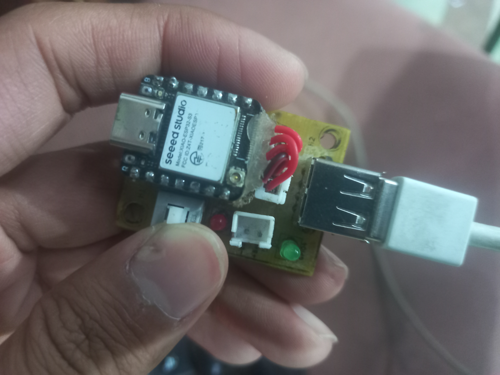
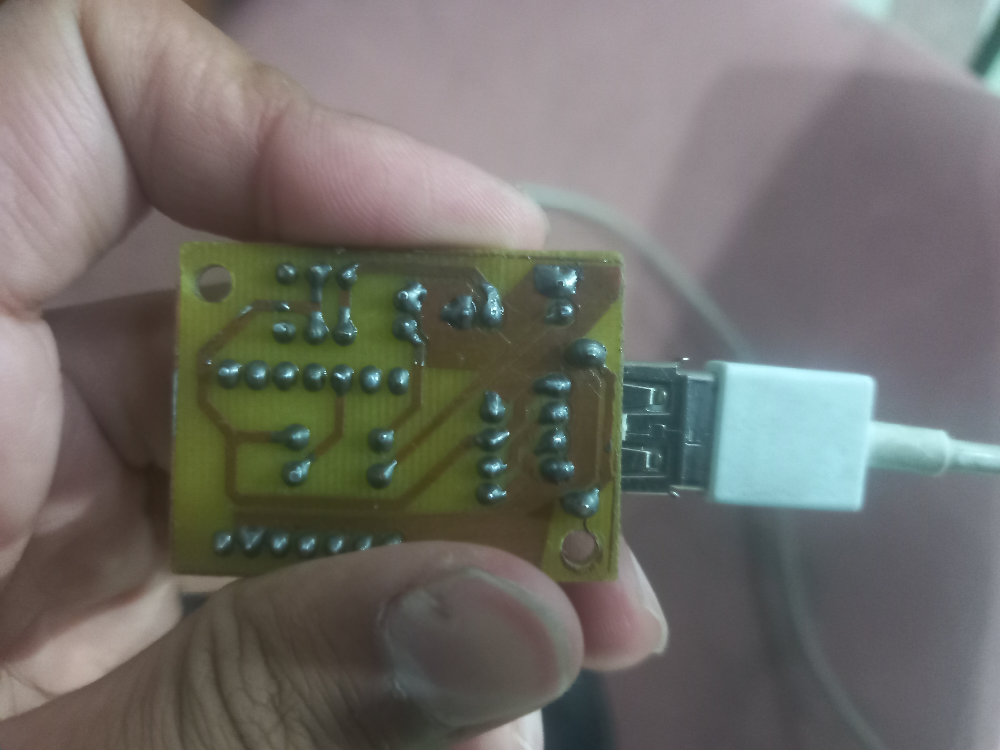
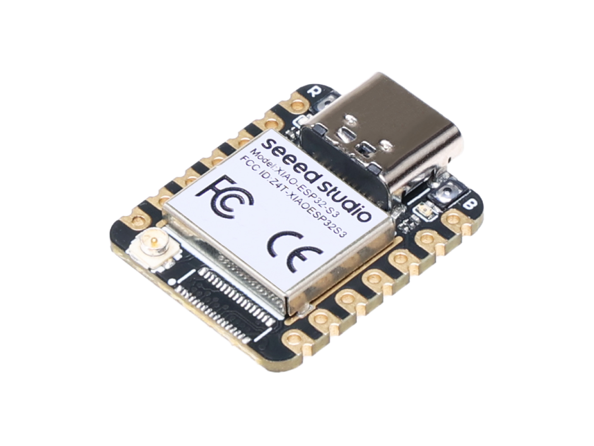
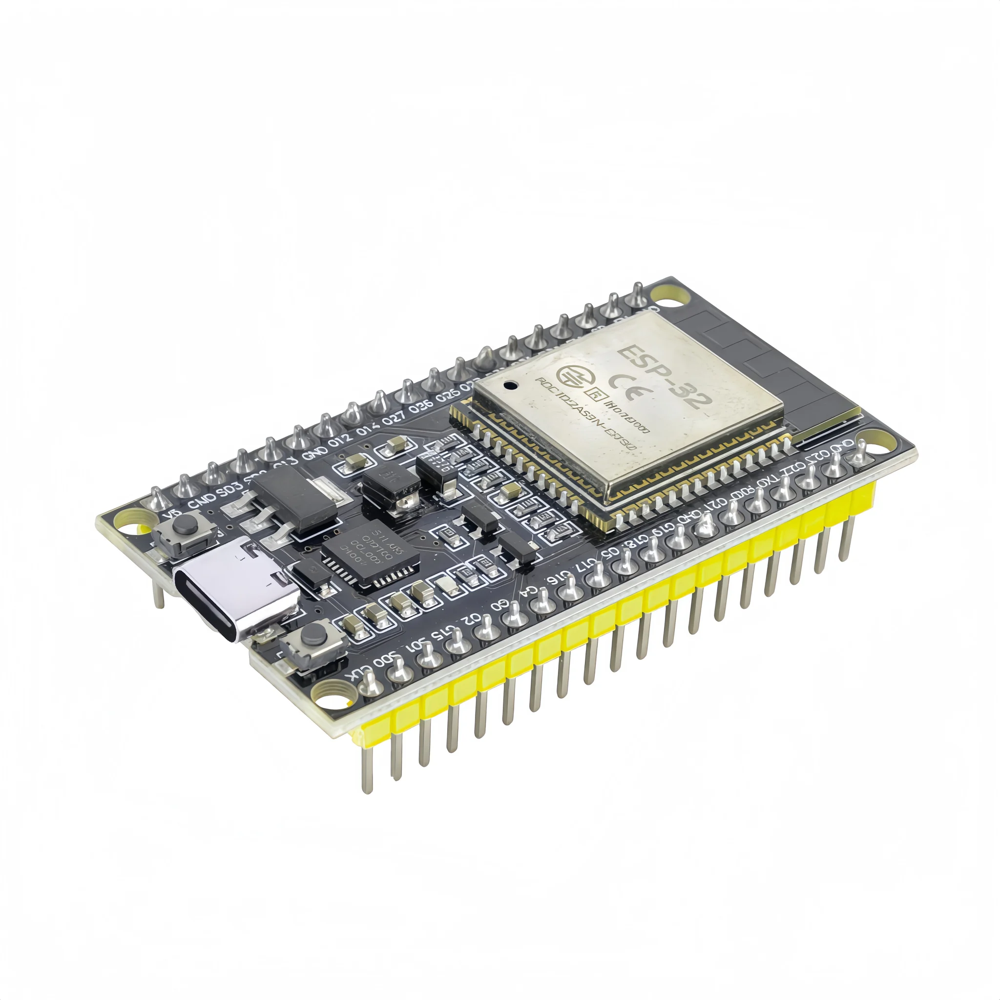

# ESP32 Joystick → Robot Communication

A wireless joystick-to-robot link built on two ESP32 boards. Plug a **PS4 (DS4) controller** into the joystick ESP over USB, flip a switch, and its input is streamed to the robot over **Wi-Fi (TCP)** or **BLE (GATT)**. The robot ESP forwards the data to your motor controller over UART.

<p align="center">
  
</p>
<p align="center">
  
</p>

## Features

- **Selectable protocol**: Wi-Fi (TCP) or BLE, chosen by a hardware switch (no reflashing)
- **USB HID host**: reads a DualShock 4 directly, no Bluetooth pairing with the controller
- **Compact 17-byte packet** with sticks, triggers, buttons, IMU and CRC
- **~30 Hz TCP / ~100 Hz BLE write rate**, with `TCP_NODELAY` and Wi-Fi power-save disabled for low latency
- **Auto-reconnect** on both protocols, and the controller state is zeroed on disconnect (safe stop)
- Built with **ESP-IDF v5.5**

## Hardware

| Side | Board | Notes |
|------|-------|-------|
| Joystick | **Seeed Studio XIAO ESP32-S3** (external antenna) | Must be an S3 (USB-OTG host). Controller on USB D+/D− (GPIO20/19) |
| Robot | **ESP32-WROOM-32** (external antenna) | Outputs the joystick packet over UART2 |

<p align="center">
  
  
</p>
<p align="center">
  
  
</p>

> Other ESP32 boards can work for the robot side. The joystick side needs a chip with USB-OTG (ESP32-S2/S3).

## Structure

```
.
├── wifi_ble_joystick/   # Joystick ESP (ESP32-S3): USB HID host + TCP client / BLE GATT client
└── wifi_ble_robot/      # Robot ESP (ESP32): TCP server / BLE GATT server + UART output
```

## How it works

```
 DS4 ──USB──► Joystick ESP ──── Wi-Fi (TCP :3333) ────► Robot ESP ──UART──► Motor driver
                  (XIAO S3)  └── BLE (GATT 0x00FF/0xFF01) ┘   (WROOM)
```

**Protocol select (read once at boot):**

| Board | Switch pin | HIGH | LOW |
|-------|-----------|------|-----|
| Joystick (XIAO S3) | GPIO 9 | Wi-Fi / TCP | BLE |
| Robot (WROOM) | GPIO 18 | Wi-Fi / TCP | BLE |

Both boards must be set to the **same mode**. Changing the switch while running triggers an automatic restart. Use an external pull-down on the switch pin.

**Packet (17 bytes, packed):**

| Field | Type | Description |
|-------|------|-------------|
| `start_byte` | u8 | `0xA5` |
| `lx, ly, rx, ry` | i8 ×4 | Stick axes |
| `lt, rt` | u8 ×2 | Triggers |
| `buttons` | u16 | Button bitmask |
| `status` | u8 | Controller status |
| `accX, accZ, accY` | i16 ×3 | IMU |
| `crc` | u8 | CRC-8 |

**Robot UART output:** UART2, `TX=GPIO17`, `RX=GPIO16`, `115200` baud.

**BLE:** the robot advertises as `ROBOT_2_GATT` (service `0x00FF`, characteristic `0xFF01`).

## Getting Started

**Requirements:** [ESP-IDF v5.5](https://github.com/espressif/esp-idf/tree/release/v5.5)

### 1. Configure Wi-Fi (TCP mode)

- **Robot:** `idf.py menuconfig` → *Example Connection Configuration* → set SSID and password. The TCP port is under *Example Configuration* (default `3333`).
- **Joystick:** in `wifi_ble_joystick/main/main.c`, edit:
  ```c
  #define SERVER_IP    "192.168.x.x"   // robot's IP (shown in its serial log)
  #define SERVER_PORT  3333
  // and the .ssid / .password in wifi_init_sta()
  ```

### 2. Build & flash

```bash
# Robot (ESP32-WROOM)
cd wifi_ble_robot
idf.py set-target esp32
idf.py -p <PORT> build flash monitor

# Joystick (XIAO ESP32-S3)
cd wifi_ble_joystick
idf.py set-target esp32s3
idf.py -p <PORT> build flash monitor
```

### 3. Run

1. Set both mode switches (Wi-Fi or BLE).
2. Power the robot first, then the joystick.
3. Plug the DS4 into the joystick ESP's USB port.
4. For Wi-Fi mode, note the robot's IP from its serial monitor and set it as `SERVER_IP`.

## Tips

- No LED/serial output on the S3? Check you flashed the right USB port, since the S3 has native USB.
- BLE writes are throttled (10 ms delay) because the BLE stack can't handle higher rates without triggering watchdog resets.
- Wi-Fi mode needs both ESPs on the same network.

## References

- [ESP-IDF USB HID host example](https://github.com/espressif/esp-idf/tree/master/examples/peripherals/usb/host/hid)
- [ESP-IDF Bluedroid GATT client/server examples](https://github.com/espressif/esp-idf/tree/master/examples/bluetooth/bluedroid/ble)
- [DS4-USB dev wiki](https://www.psdevwiki.com/ps4/DS4-USB)
- [XIAO ESP32-S3 docs](https://wiki.seeedstudio.com/xiao_esp32s3_getting_started/)

## License

MIT: add a `LICENSE` file, or change this to your preferred license.